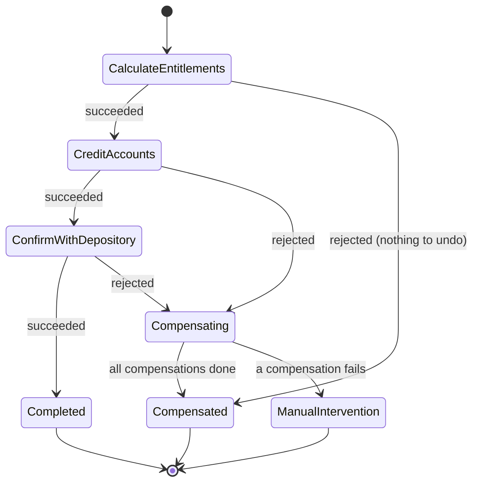
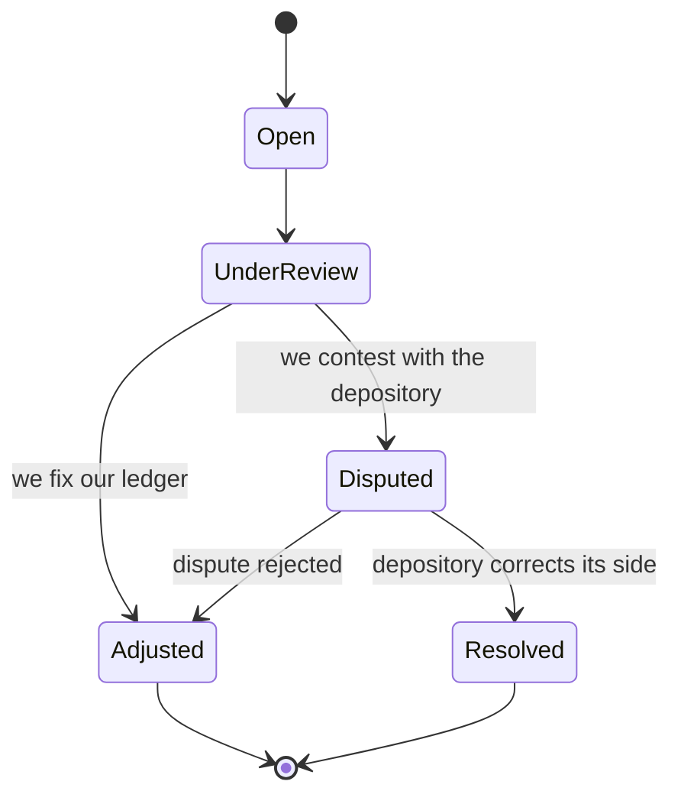

# CUSTODY-RECONCILIATION

Event-oriented custody reconciliation and corporate-actions payout engine, modeled on how a securities depository and its custody agents work: reconcile positions, detect breaks, compute entitlements and pay them out safely, even when the process dies halfway.

Built on **Hexagonal Architecture (Ports & Adapters)** with an immutable, framework-free Kotlin domain.

> **Scope and disclaimer.** This is a study project. The domain is *inspired by* the role a depository such as B3 plays in the Brazilian market, but everything here is simulated. It is not affiliated with or endorsed by B3, it does not integrate with any real system, and file formats, participant codes and corporate-action rules are simplified. Do not use it to move real money.

---

## Why this project exists

It started from [`str-xml-pipeline`](https://github.com/Doug16Yanc/str-xml-pipeline), an interbank settlement pipeline addressed to the central bank. The infrastructure choices (Kafka, PostgreSQL, Redis, S3) carry over; the domain does not. Here the recipient is a **depository**, and the interesting problems change:

- Two sources of truth that must agree (the depository's positions and our ledger).
- Money that must be split without losing or inventing a cent.
- A multi-step payout that must survive crashes, timeouts and rejections.

---

## Architecture Overview

Dependencies point inwards: infrastructure adapts to domain and application contracts, never the inverse. The domain has no framework, database or messaging imports.

### Payout saga

Paying out one corporate event is a saga with three forward steps. If a step is rejected, the steps that already succeeded are undone in reverse order.



Compensations run most-recent-first: `REVERSE_CREDITS`, then `DISCARD_ENTITLEMENTS`.

### Reconciliation break lifecycle



---

## Stack

### Implemented today

- Kotlin, pure domain with structural invariants enforced in `init` blocks
- Sealed hierarchies for state machines (`BreakStatus`, `SagaState`) and corporate events (`CorporateEvent`)
- Value objects: `Isin` (with check-digit validation), `Money`, `Quantity`, `Rate`, `AgentCode`, `InvestorAccount`
- Exact integer arithmetic for money and quantities, no floating point
- In-memory adapters for every outbound port, so the whole flow runs with no infrastructure
- JUnit 5 + `kotlin-test`
- Maven (wrapper included)

### Roadmap (not implemented yet)

| Component | Planned role |
| --- | --- |
| Spring Boot | Application wiring, REST API, scheduling |
| PostgreSQL | `SagaRepository` with a unique key per event and optimistic locking; bulk position ingestion via `COPY` |
| Apache Kafka | Command and event bus, fed by a transactional outbox |
| Redis | File-level idempotency filter; token blacklist |
| Amazon S3 | Immutable storage for raw depository files and dispute XML |
| JAXB | Deterministic XML for break disputes |

Security (HTTP-only cookie JWT, Argon2id, Redis blacklist) is inherited from the original project and will be adapted to reconciliation roles.

---

## Core Design Decisions

### 1. Money conservation with the largest-remainder method

`LargestRemainderDistributor` splits a payout across investors proportionally to the quantity held. R$ 10.00 across three equal holders is not three times R$ 3.33:

```
ACC-A  BRL 3.34
ACC-B  BRL 3.33
ACC-C  BRL 3.33
       ---------
       BRL 10.00
```

- **Conservation:** the shares always add up to the total, checked before returning.
- **Fairness:** every share is its exact value rounded down, or that plus one cent.
- **Determinism:** ties are broken by account id, so the result never depends on input order.
- **Exact arithmetic:** done in `BigInteger`, on cents and on 10⁻⁶ share units.

### 2. Retry or compensate: it depends on who said no

Outbound ports distinguish two kinds of failure.

- `RejectedException` is a definitive refusal. Retrying cannot help, so the saga fails the step and compensates.
- `TransientFailureException` may go away. The step is retried up to a limit; if it keeps failing, the orchestrator **pauses** without failing the saga, and it can be resumed later.

### 3. Effectively-once from at-least-once

The orchestrator saves the saga after every transition and executes steps *at least once*: a crash between "action done" and "state saved" means the action runs again on resume. What makes that safe is that every port is **idempotent per saga id**. Crediting the same payout twice has the same effect as crediting it once.

### 4. Write-ahead attempt log

Each attempt is written to the saga's log and saved **before** the action runs. If the process dies mid-action, the saved log shows an attempt that started and never finished, instead of silently losing it.

### 5. Compensation is a new entry, never a deletion

Undoing a credit appends an opposite ledger entry. History stays intact and auditable.

### 6. One saga per event

Starting the same event twice continues the existing saga instead of creating another one, which prevents paying an event twice. A saga that already compensated is not retried automatically.

### 7. Fractions are reported, not dropped

Bonus issues and reverse splits produce fractions of a share. `ShareEntitlement.residual` carries what could not be credited, truncated to six decimal places, so residuals can be pooled and handled explicitly.

### 8. Immutable, clock-injected domain

Every state transition returns a new instance with an extended audit trail. Time is always passed in (`Clock` / `Instant`), never read from the system clock, so behavior is deterministic in tests.

---

## Demo

The demo runs four scenarios of the same payout (R$ 10.00 across three holders) with no framework and no I/O. Run the `main` function in `SagaDemo.kt` from your IDE.

1. **Happy path**
2. **The depository rejects:** credits are reversed, entitlements discarded
3. **Two timeouts, then success:** retried, no compensation
4. **Crash after crediting, then resume:** credited exactly once

Excerpt from scenario 4:

```
!! process died after crediting, before saving the result
saved state after the crash: AwaitingStep(next=CREDIT_ACCOUNTS)
ledger entries already written: 3
-- restarting and resuming --
- saga started
- starting CALCULATE_ENTITLEMENTS (attempt 1/3)
- CALCULATE_ENTITLEMENTS succeeded
- starting CREDIT_ACCOUNTS (attempt 1/3)
- resumed from saved state AwaitingStep(next=CREDIT_ACCOUNTS)
- starting CREDIT_ACCOUNTS (attempt 1/3)
- CREDIT_ACCOUNTS succeeded
- starting CONFIRM_WITH_DEPOSITORY (attempt 1/3)
- CONFIRM_WITH_DEPOSITORY succeeded
final state: Completed
ledger: CREDIT ACC-A BRL 3.34
ledger: CREDIT ACC-B BRL 3.33
ledger: CREDIT ACC-C BRL 3.33
```

`starting CREDIT_ACCOUNTS` appears twice and the ledger still has three credits, not six.

---

## Domain Directory Layout

```
tech.custodyreconciliation
├── domain
│   ├── model
│   │   ├── shared          — Isin, Money, Quantity, AgentCode, InvestorAccount
│   │   ├── position        — PositionKey, PositionRecord, PositionType
│   │   ├── reconciliation  — ReconciliationBreak, BreakStatus, BreakType, BreakTransition
│   │   ├── event           — CorporateEvent (Dividend, InterestOnEquity, BonusShares,
│   │   │                     StockSplit, ReverseSplit), Rate, Entitlement
│   │   └── saga            — PayoutSaga, SagaState, SagaStep, CompensationStep
│   ├── service             — LargestRemainderDistributor, PositionReconciler,
│   │                         EntitlementCalculator
│   └── exception           — domain-scoped typed exceptions
│
├── application
│   ├── PayoutSagaOrchestrator
│   ├── port
│   │   └── out             — SagaRepository, EntitlementPort, LedgerPort, DepositoryPort,
│   │                         RejectedException, TransientFailureException
│   └── demo                — SagaDemo (four runnable scenarios)
│
└── infrastructure
    └── inmemory            — InMemorySagaRepository, InMemoryEntitlementStore,
                              InMemoryLedger, InMemoryDepository
```

Persistence, messaging, storage, security and web adapters inherited from the original project are being replaced incrementally.

---

## Local Development

### Prerequisites

- A JDK compatible with the version configured in `pom.xml`
- Maven (or the included wrapper)

### Run the tests

```
./mvnw test
```

The suite covers value-object validation, the money-conservation property (randomized, fixed seed), the break and saga state machines, entitlement calculation, and the orchestrator scenarios, including crash-and-resume.

### Run the demo

Run `main` in `SagaDemo.kt` from your IDE.

### Infrastructure

Docker Compose files inherited from the original project (PostgreSQL, Redis, Kafka, LocalStack S3) will be revisited as each adapter lands. The domain, the saga and the demo need none of it.

---

## Known Limitations

- Retries are immediate; a real adapter needs backoff and jitter.
- No concurrency control yet: two workers could advance the same saga until the PostgreSQL adapter adds optimistic locking.
- Commands are direct calls, not messages. The transactional outbox is part of the Kafka step.
- Tax on interest on equity is not modeled and should be a pluggable policy with effective dates.
- Fraction handling for bonus issues and reverse splits is a generic model, not an official procedure.
- `AgentCode` and `InvestorAccount` formats are simplified assumptions.

---

## Key Characteristics

Hexagonal Architecture · Immutable Domain · Sealed State Machines · Saga Orchestration · Idempotent Ports · Write-Ahead Attempt Log · Compensation by Reversal · Exact Integer Money Arithmetic · Largest-Remainder Distribution · Deterministic, Clock-Injected Tests